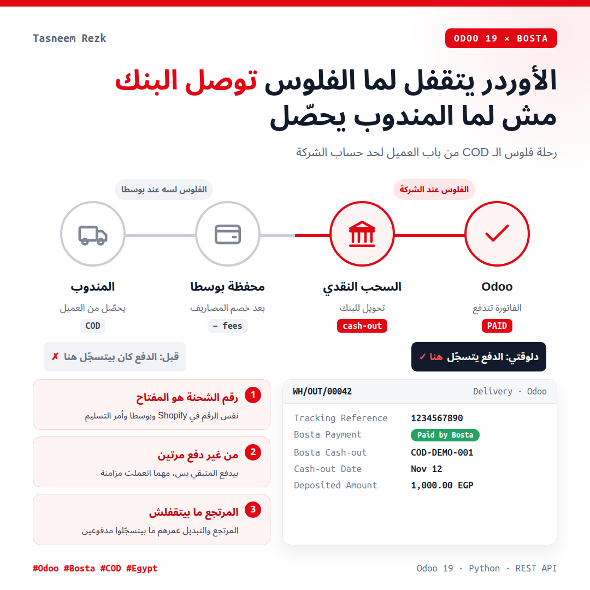

# Case Study 05 — Cash-on-Delivery Settlement with a Courier (Bosta)

> **Stack:** Odoo 19 · Python · REST (read-only) · Shopify connector
> **Fictional client:** _Saffron & Sage_ — a direct-to-consumer personal-care brand selling through Shopify, shipping across Egypt with Bosta, mostly cash on delivery.
> **Type:** Inbound, read-only settlement integration, built from scratch.

> ℹ️ **A note on this case study.** It is based on a real production integration. The client is fictionalized, every number shown is a placeholder, and no source code is reproduced — only the architecture, the decisions, and rewritten illustrative patterns. Bosta is named because it is a public courier service; nothing here describes its private API beyond what any customer can see.

Part two of this story is [Case 06 — Card Payment Settlement (Paymob)](../06-card-gateway-settlement/): same question, different payment method.

---

## For a business reader

**When is an order "paid"?**

For a cash-on-delivery store, the obvious answer is wrong. The order was being marked paid in Odoo the moment the courier collected the cash from the customer. But at that moment the money isn't the company's yet: it sits in the courier's wallet, the courier deducts its fees, and the rest is transferred to the bank days later, in one payout that covers many orders.

So the books said "paid" while the bank said "not yet," and the gap grew with every order. The accountant closed it by hand, matching payout statements to orders line by line.

The rule we agreed with the client:

> ✅ An order is paid when its money reaches the company's bank account, not when the courier collects it.

The result: every delivered order is closed automatically, on the date the courier actually transferred its money, with the payout reference written on the payment so the accountant can trace it. Returned or exchanged shipments are never marked paid.

## For a technical reader

**Problem.** For every outgoing delivery of a Shopify order shipped with Bosta, decide whether its cash-on-delivery money has been **paid out to the business**, and when it has, register the invoice payment, automatically and exactly once.

1. **Find a stable key.** Orders come from Shopify, shipments are created by the courier's Shopify app, invoices live in Odoo. The tracking number is the one value all three systems share, so it is the join key. (The tracking number itself reaches the delivery through a separate fulfillment-sync module.)
2. **Map courier states to a payment status.** The courier exposes delivery states (pickup requested, in transit, delivered, returned…). These are folded into a small, explicit payment status on the delivery: `Pending collection → Collected → Paid by courier`, plus `Prepaid` (nothing to collect) and `Not collected` (returned, cancelled).
3. **Tie each delivery to its payout.** A delivery only counts as paid once it can be resolved to the payout batch that settled it. The payout reference and date are stored on the delivery.
4. **Pay the invoice idempotently.** The payment is registered for the **open residual only**, in a configurable journal, dated on the payout date. Running the sync once or ten times gives the same books.
5. **Stay read-only.** The integration never writes anything to the courier.

---

## Constraints & Considerations

- **Accounting correctness beats speed.** A payment registered a day late is fine; a payment registered twice, or for a returned parcel, is not.
- **Returns are the trap.** A return shipment carries no amount to collect, so a naive rule ("nothing to collect means prepaid") would mark it paid. Return states are checked first.
- **No manual uploads.** No Excel import, no statement matching. If a person has to do something every day, the integration has failed.
- **Never trust "later" over "done".** Once money is collected, a later, stale answer from the API can't move the status backwards.
- **One bad API key must not stop everything.** Errors are isolated per company, and per record.
- **Visibility is a permission.** The courier fields and the manual sync button belong to a dedicated *Courier User* group, not to every salesperson.

---

## Architecture

See [`architecture.md`](./architecture.md) for the full diagrams.

```
Shopify order ──► Odoo sale order ──► delivery (tracking number)
                                            │
                    scheduled sync / manual button (read-only)
                                            │
                                            ▼
                                  courier: shipment state + payout
                                            │
                       ┌────────────────────┼──────────────────────┐
                       ▼                    ▼                      ▼
               Pending collection       Collected            Prepaid / Not collected
                                            │                  (never paid by this flow)
                                  in a settled payout?
                                            │ yes
                                            ▼
                        register payment for the open residual,
                        dated on the payout date ──► Paid by courier
```

---

## Key Technical Decisions

- **The delivery owns the state, the order shows it.** The status lives on `stock.picking` (one shipment, one tracking number); the sale order exposes a stored computed status of its latest delivery, so the order list can be filtered and grouped.
- **Explicit status mapping, returns first.** A small pure function turns (courier state, amount to collect) into a status. It's unit-tested without any HTTP.
- **Monotonic status.** `Collected` and `Paid by courier` are never downgraded by a later sync.
- **Residual-only payments.** The invoice is paid through Odoo's standard payment wizard for whatever is still open. That makes the operation idempotent, and safe alongside any other module that might pay the same invoice.
- **Batch-safe cron.** Least-recently-synced first, bounded batch, a savepoint per record, progress committed as it goes, and a company is skipped for the rest of the run once its key is rejected.
- **Bounded scope.** Only deliveries from the last 60 days that are still open, or collected but not paid out, are polled, so the cron cost doesn't grow with history.
- **Fees are informational.** The amount actually deposited after fees is stored on the delivery, but the invoice is closed in full. Booking courier fees per payout was deliberately left as a separate, client-approved step.

---

## Illustrative Snippets

See [`snippets.md`](./snippets.md): rewritten, generic patterns, not the production source.

---

## Screenshots

| Screenshot | What it shows |
|---|---|
|  | The money journey (courier → courier wallet → payout → Odoo) and where "paid" is now recorded. All values are placeholders. |

---

## What I Learned

> The hardest part wasn't the code. It was agreeing on one clear definition of "paid". Once that definition was explicit, the solution became small.

1. **Define the business state before modeling it.** "Paid" meant three different things to sales, the courier, and accounting. Writing the rule down in one sentence removed most of the complexity.
2. **Look for the shared key before building a pipeline.** The first ideas were heavy: file imports, statement reconciliation. The tracking number already linked every system.
3. **Idempotency is the cheapest safety net.** Paying only the residual turned "what if the cron runs twice?" from a risk into a non-question.

---

## Want to Talk Through This One?

The module runs for a real client, so the source stays private. I'm glad to walk through the status mapping, the idempotency design, and the cron strategy live in an interview.
