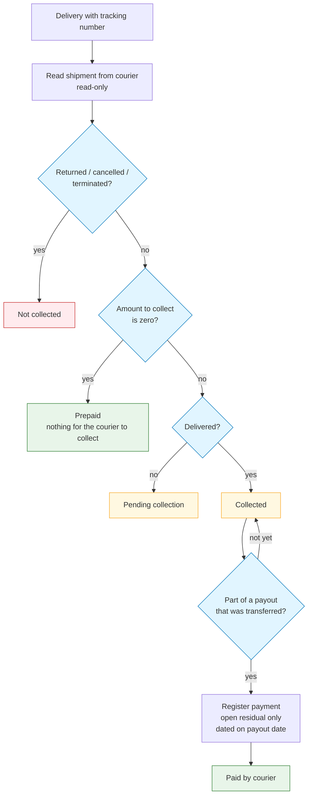
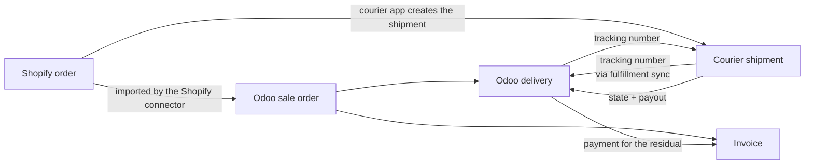
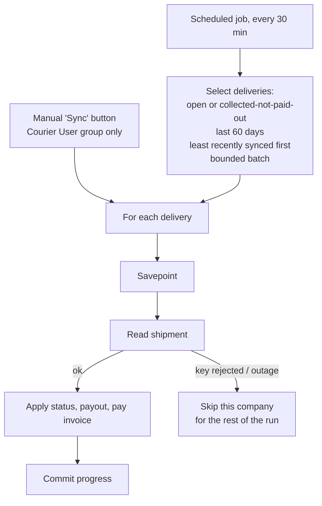

# Architecture — Cash-on-Delivery Settlement with a Courier

## Payment Status Lifecycle



Order of the checks matters: a return shipment carries no amount to collect, so checking "zero amount" first would label returns as prepaid.

---

## Systems and the Shared Key



The tracking number is the only identifier all three systems agree on, so every lookup goes through it.

---

## Sync Strategy



---

## Module Layout (illustrative — generic names)

```
courier_cod_settlement/
├── models/
│   ├── courier_api.py        thin read-only HTTP client: auth header, timeouts, 404/401 handling
│   ├── stock_picking.py      status mapping, apply shipment data, register payment, cron
│   ├── sale_order.py         stored computed status of the latest delivery
│   └── res_company.py        API key, API URL, payout journal
├── security/
│   └── res_groups.xml        "Courier User" group
├── data/
│   └── ir_cron.xml           30-minute safety-net sync
├── views/                    delivery tab, order list badge, filters, group-by
└── tests/                    status mapping, idempotent payment, returns, group access
```

## Why This Layout

- **The HTTP client knows nothing about Odoo business rules**, and the business rules never build URLs. Each can be tested on its own.
- **The status mapping is a pure function** of (state, amount to collect), so every edge case is a one-line test.
- **Payment goes through Odoo's standard register-payment wizard**, not hand-built journal entries, so reconciliation, payment state, and reports behave exactly like a manual payment.
