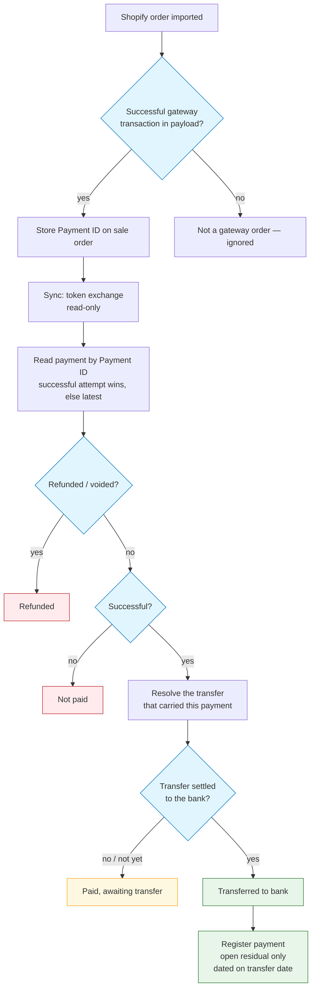
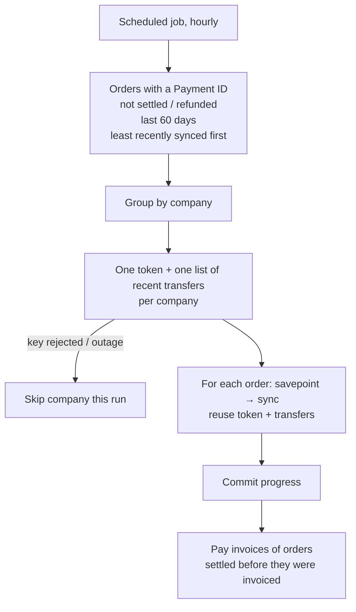
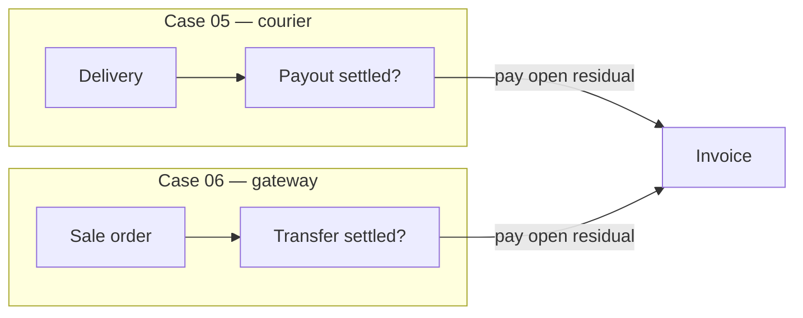

# Architecture — Card Payment Settlement with a Payment Gateway

## From Shopify Order to Paid Invoice



---

## Batch Strategy



---

## Two Settlement Modules, One Rule



No dependency between the two modules: residual-only payments make them safe side by side.

---

## Module Layout (illustrative — generic names)

```
gateway_card_settlement/
├── models/
│   ├── gateway_api.py      token exchange, request wrapper, payment lookup, paginated transfers
│   ├── sale_order.py       import hook, status mapping, transfer resolution, payment, crons
│   └── res_company.py      API URL, API key (group-restricted), settlement journal
├── security/
│   └── res_groups.xml      "Gateway User" group
├── data/
│   └── ir_cron.xml         hourly sync
├── views/                  order tab, list badge, filters, company settings
└── tests/                  import hook, retries, status mapping, idempotent payment, access
```
